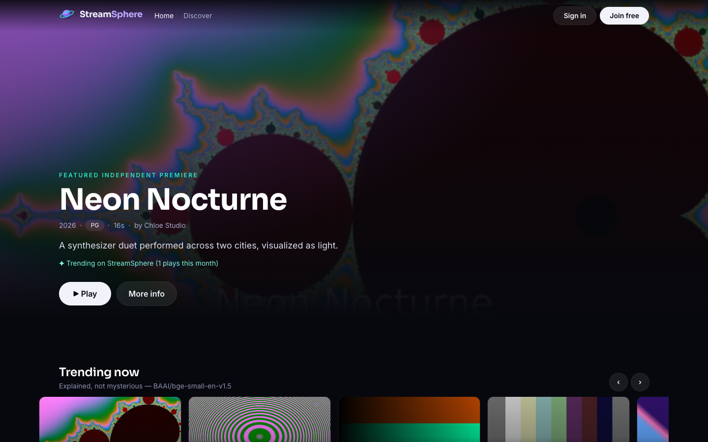

# StreamSphere AI

A creator-first video-on-demand platform for **independent, original and openly licensed films**, built as
strictly separated microservices with a real media pipeline, secure adaptive streaming, explainable AI
discovery, and zero-cost-first operations.

**Maintainer:** Raahul Sallagunta · **License:** MIT (FFmpeg worker image contains GPL binaries)



## What actually works (verified 2026-10-22, local)
- **Upload → FFmpeg → HLS:** resumable browser-direct multipart upload (presigned), server-side verification
  (parts/ETags, size, container signature, sha256), source-aware 360/480/720p ladder with aligned keyframes,
  posters, thumbnails, WebVTT captions — as a queue worker **or a Kubernetes Job** (k3s verified).
- **Secure playback:** HMAC session tokens on every playlist and segment, 60-second presigned segment redirects,
  per-session/title revocation, takedown deletes media. *Access control, not DRM.*
- **Discovery:** PostgreSQL full-text + pgvector semantic search (RRF fusion, typo tolerance) using a local
  `BAAI/bge-small-en-v1.5` ONNX model; explainable recommendations with cold start.
- **Trust & safety:** rights attestations, review queue, reasons, appeals, reports, takedowns, audit trails.
- **Creator analytics & QoE:** startup time, rebuffering, completions, k-anonymised viewer counts.
- **Angular 22 SPA:** cinematic dark design, keyboard/screen-reader accessible (axe WCAG 2.2 AA gate in tests).
- **Reliability:** transactional outbox/inbox, retries with jitter, DLQ + replay, reconcilers, restore drill.
- **Optional (local-full):** tus 1.0 resumable uploads via tusd hooks, Kafka replayable analytics log, OpenTelemetry
  traces + logs (Tempo/Loki), Prometheus alerts, Grafana dashboard. Paid video providers exist only as guarded stubs.

| Evidence | Result |
|---|---|
| JVM unit + Testcontainers | 103 passed |
| Recommendations pytest | 4 passed |
| API e2e (pipeline / platform / tus / Kafka replay) | 20/20 · 59/59 · 9/9 · 4/4 |
| Playwright + axe (real Chrome HLS, production web image) | 13/13 |
| Failure drills (worker SIGKILL, broker restart, storage/cache outage, pod restart) | 5/5 |
| k6 (20 VUs, 60 s) | 0 % errors, playback-auth p95 206 ms |
Details: [docs/benchmarks/2026-10-22-local.md](docs/benchmarks/2026-10-22-local.md)

## Quick start (local-core, ~4 GB RAM for Docker)
```bash
cp .env.example .env          # local, non-secret defaults
make up                       # builds jars + images, starts 19 containers, waits for health
python3 scripts/seed_demo.py  # publishes 10 self-generated CC0 films through the real pipeline
```
The production web app (Angular 22, nginx) is part of the stack. Open http://localhost:4200 and sign in with a seeded **local test user** (see `infrastructure/docker/keycloak/streamsphere-realm.json`:
viewer, creator, moderator, admin). Gateway: :8080 · Keycloak: :8180 · RabbitMQ UI: :15672 · MinIO console: :9001.

Deploy elsewhere: [docs/runbooks/deploy.md](docs/runbooks/deploy.md). More: `make e2e` · `python3 tests/resilience/drills.py` · `make up-full` (OTel/Tempo/Loki/Prometheus/Grafana/Kafka) ·
`scripts/k8s-local-up.sh` + `compose.k8s.yaml` (FFmpeg as Kubernetes Jobs) · `scripts/backup.sh` / `scripts/restore-drill.sh`.

## Architecture
13 independently deployable services (12 Spring Boot 4 + 1 FastAPI) behind a Spring Cloud Gateway, each with its
own PostgreSQL database and role, RabbitMQ events, Valkey cache, S3-compatible storage, Keycloak OIDC.
→ [docs/architecture](docs/architecture/README.md) · [ADRs](docs/adr) · [threat model](docs/architecture/THREAT_MODEL.md)

## Cost & cloud status
Zero-cost-first. Cloud deployment (OCI Always Free + Cloudflare R2/Pages) is **designed but not deployed**:
providers require a card and offer no hard spending cap, so provisioning is blocked pending the owner's checklist
in [FREE_TIER_VERIFICATION.md](docs/cost/FREE_TIER_VERIFICATION.md). Paid video providers are disabled by design.

## Legal
Only self-generated CC0 test media is included ([fixtures](tests/fixtures/media/README.md)). No Netflix or other
third-party branding, artwork or catalogs. Privacy policy / takedown texts are templates for legal review.
