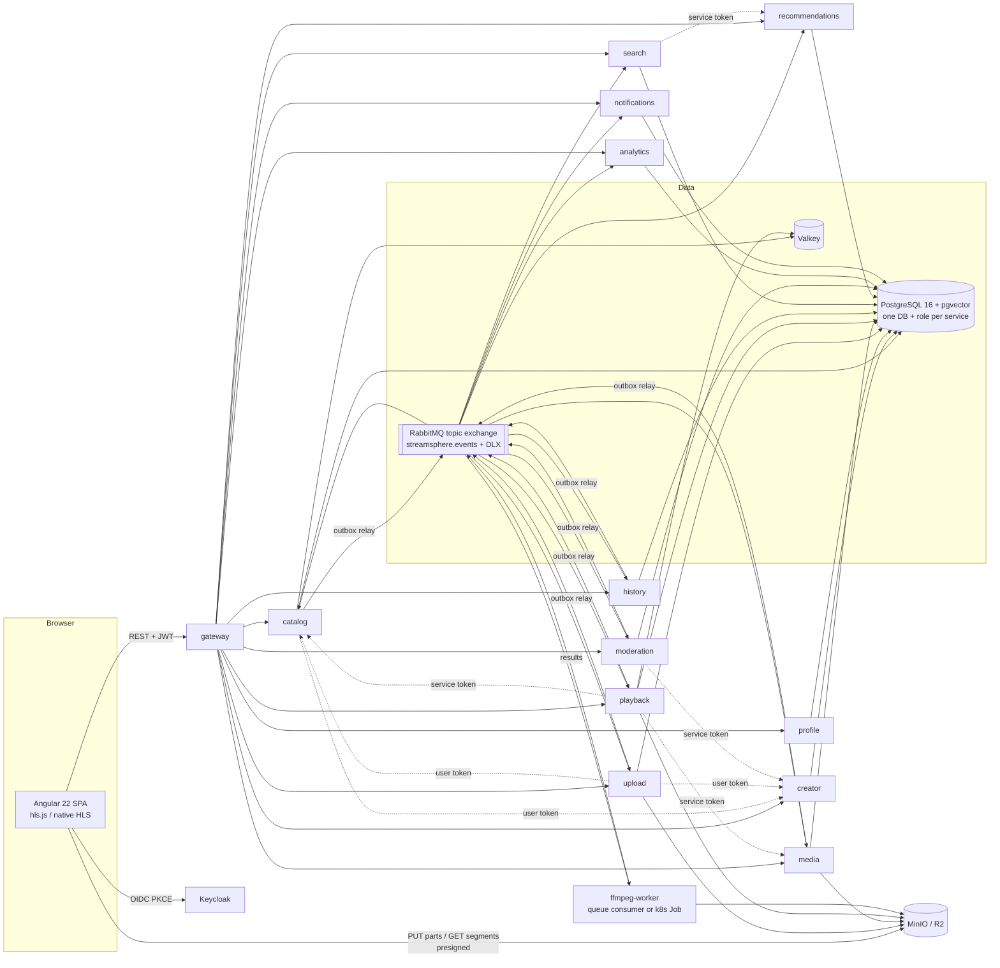

# C4 — Containers (local-core, as run by `docker compose`)

Dotted lines are synchronous API calls (never database access). Optional local-full containers: OTel
Collector, Tempo, Loki, Prometheus, Grafana, Kafka, Mailpit.
