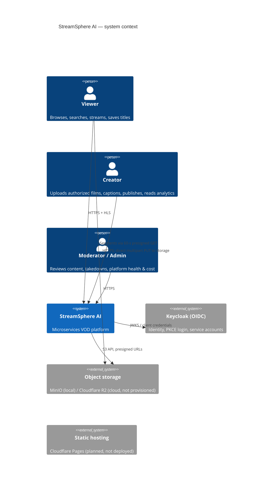

# C4 — System context

Media bytes never flow through the gateway or any service: browsers PUT parts to storage and GET segments
from storage using short-lived signatures issued after authorization.
