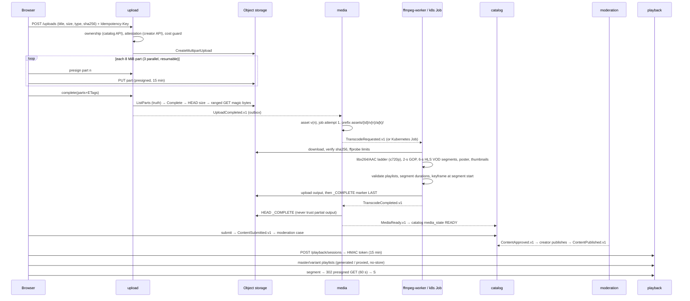

# Media pipeline (implemented)

## States
- Upload: `INITIATED → UPLOADING → UPLOADED | FAILED | CANCELLED | EXPIRED`
- Media (processing): `QUEUED → PROCESSING → READY | FAILED`, `DELETED` on takedown; job: `QUEUED → RUNNING → SUCCEEDED | FAILED | TIMED_OUT`
- Catalog (editorial, separate): `DRAFT → IN_REVIEW → APPROVED → PUBLISHED`, `REJECTED` (edit/resubmit/appeal), `REMOVED` (terminal)

## Failure handling (each verified — see docs/benchmarks/2026-10-22-local.md)
| Failure | Mechanism | Evidence |
|---|---|---|
| Worker killed mid-encode | request un-acked → redelivered → re-run; reconciler fails overdue jobs and retries (max 3 attempts, fresh prefix each) | drill PASS |
| Duplicate UploadCompleted / results | inbox dedup; `media_assets.upload_id` unique; job state checks | unit/integration + e2e |
| Corrupted / non-video input | magic sniff at completion (422, object deleted); ffprobe in worker → non-retryable FAILED | e2e PASS |
| Partial HLS output | validator before upload; `_COMPLETE` written last and checked before READY | unit tests |
| Abandoned multipart | reconciler aborts after 24 h | code + unit |
| Takedown / creator deletion | ContentRemoved → revoke sessions, delete all asset prefixes, remove from search/catalog, delete source | e2e PASS |
| Broker restart | outbox keeps events; relays/consumers reconnect | drill PASS |

**Upload protocols** (`UploadProvider`): S3 multipart (SPA default) and **tus 1.0** via tusd (`pre-create` hook = auth/ownership/rights/quota admission, `post-finish` hook = same object verification + `UploadCompleted.v1`). Both share `UploadService.verifyAndPublish`.

FFmpeg arguments are built as argv arrays (no shell; unit-tested). Limits: ≤3 h, ≤4096×2304, ≤16 streams, per-job wall timeout, worker CPU ≤2, memory ≤1.5 GB.
